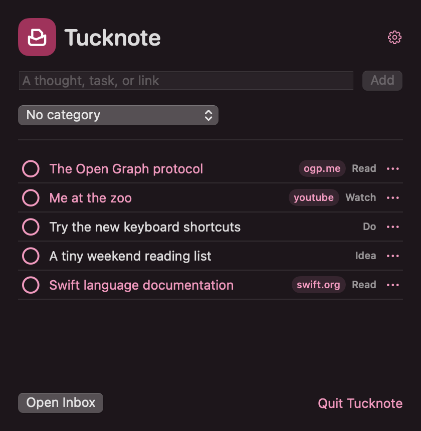
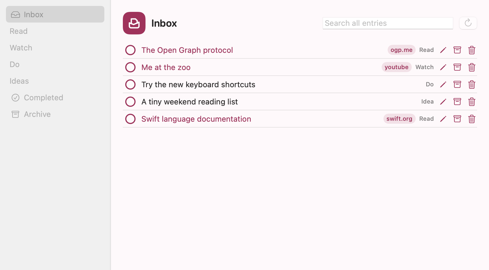

<p align="center">
  
</p>

<h1 align="center">Tucknote</h1>

<p align="center">A little menu bar inbox for links, notes, and tasks.</p>

<p align="center">
  <a href="#install">Install</a> ·
  <a href="#what-you-can-do">Features</a> ·
  <a href="#keyboard-shortcuts">Shortcuts</a> ·
  <a href="#contribute">Contribute</a>
</p>

<p align="center">
  
  
  <a href="LICENSE"></a>
  <a href="https://github.com/Scheegl/tucknote/actions/workflows/check.yml"></a>
</p>

<p align="center">
  
</p>

## What you can do

- **Capture in seconds.** Click the pocket in the menu bar or press **Control + Option + Space**. Type or paste, then press **Return**.
- **Find what you saved.** Search the full Inbox, including **Completed** and **Archive**. Click a source tag such as `youtube` to filter entries from that site.
- **Keep links readable.** Tucknote labels links by source, can fetch titles over HTTPS, and points you to the original if you save the same YouTube video through a different link.
- **Clear your inbox.** Click the circle to complete an entry. Right-click a row or use **…** to edit it, change its category, copy its link, or archive it.
- **Make it yours.** Choose **System**, **Light**, or **Dark** appearance. Settings also controls the menu bar count and launch at login.

<p align="center">
  
</p>

## Install

**Requirements:** macOS 13 or later on an Apple Silicon Mac.

| Option | Status | What to do |
| --- | --- | --- |
| **Ready-to-run app** | First notarized download pending | Once listed under **Assets** on [Releases](https://github.com/Scheegl/tucknote/releases), download the app ZIP, unzip it, and drag `Tucknote.app` into **Applications**. |
| **Source ZIP** | Available now | Click **Code → Download ZIP**, unzip the source, and follow the build steps below. |
| **Git clone** | Available now | Clone the repository using the commands below. This is the easiest path for contributors and for pulling future updates. |

### Build from source

Building requires Apple's **Command Line Tools**. If they are missing, install them with `xcode-select --install`.

For a Git checkout:

```bash
git clone https://github.com/Scheegl/tucknote.git
cd tucknote
./build.sh
open build/Tucknote.app
```

For a source ZIP, open Terminal, change into the extracted folder, then run `./build.sh` and `open build/Tucknote.app`. To keep the app in **Applications**, open `build` in Finder and drag the bundle there. Quit any running copy before replacing it.

### First launch


Look for the pocket icon in your Mac's menu bar. Tucknote runs there by design. Right-click the icon for **Open Inbox**, **Settings**, **Refresh Link Titles**, **About Tucknote**, and **Quit Tucknote**.

### Update Tucknote

Right-click the pocket icon, open **About Tucknote**, and click **Check for Updates…**. This free, on-demand check compares your installed version with the latest stable [GitHub Release](https://github.com/Scheegl/tucknote/releases). It works without a GitHub account. The app shows the version and build number in the same window.

- **Installed from source?** When a new source release is available, open it from the update window and download its **Source code (zip)**. Extract it and run `./build.sh`. If you cloned the repo, fetch tags and check out the tag shown on the release page before rebuilding.
- **Installed from an app ZIP?** Open the release downloads and get the new `Tucknote-…-macos-arm64.zip`. Quit Tucknote, unzip the download, and replace `Tucknote.app` in **Applications**. Your inbox is stored separately.

Update checks run only when requested. Tucknote opens the official release page for manual installation.

## Capture from other apps

- **macOS Services:** Select text in a compatible app, then choose **Services → Capture in Tucknote**. If the service is hidden, look under **System Settings → Keyboard → Keyboard Shortcuts → Services**.
- **Shortcuts, browsers, and launchers:** Open a URL like `tucknote://capture?text=Read%20this%20later`. Pass the URL-encoded text as the single `text` parameter. In Shortcuts, encode the text before appending it to `tucknote://capture?text=`, then use **Open URLs**.

Both options stage a draft for review. Press **Add** or **Return** to save it. If you already have a draft, incoming items wait until you save it or clear the input and choose **Show Next**. The queue is temporary and clears when Tucknote quits.

## Keyboard shortcuts

| Shortcut | Action |
| --- | --- |
| **Control + Option + Space** | Open quick capture from another app |
| **Command + V** or **Control + V** | Paste into an input field |
| **Return** in quick capture | Save the draft |
| **Up / Down** | Select a row |
| **Return** on a selected row | Open its editor |
| **Command + Shift + A** | Archive the selected active entry |

## Privacy and storage

Entries stay on your Mac in `~/Library/Application Support/Laterfold/inbox.json`. Tucknote retains the original storage path so earlier installs can open the same inbox. Plain-text capture, search, and categories work offline.

YouTube titles are fetched automatically using canonical video or playlist IDs. For other HTTPS sites, Tucknote reads the page title and a short description when available. Hover over a link to see its description. You can turn off automatic fetching in Settings and use **Refresh Link Titles** on demand. Links still open when a page does not expose a title. Read [SECURITY.md](SECURITY.md) for details.

## Contribute

- **Found a bug or have an idea?** [Open an issue](https://github.com/Scheegl/tucknote/issues/new/choose).
- **Want to change the code?** See [CONTRIBUTING.md](CONTRIBUTING.md) for the build checks and pull request process.
- **Found a security issue?** [Report it privately](https://github.com/Scheegl/tucknote/security/advisories/new).
- **Preparing a release?** See the [release guide](Tools/RELEASING.md).

Tucknote is open source under the [MIT License](LICENSE).
